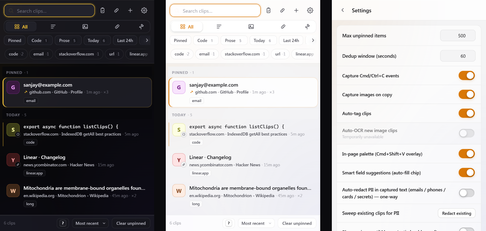

# Context Clipboard

**A clipboard history for your browser that remembers where every copy came from.**

Copy anything in Chrome, Brave, Edge or Firefox and Context Clipboard saves it with its source: the page URL, title, favicon and the paragraph around it. Text, links and images are all captured. Everything stays in your browser. There is no server, no account and no telemetry.

[](https://github.com/Sanjays2402/context-clipboard/actions/workflows/ci.yml)


<p align="center">
  
</p>
<p align="center"><sub>Dark popup · Light popup · Settings, captured from the production build</sub></p>

**Website:** https://sanjays2402.github.io/context-clipboard/ · **Changelog:** [CHANGELOG.md](CHANGELOG.md) · **Privacy:** [PRIVACY.md](PRIVACY.md) · **Terms:** [TERMS.md](TERMS.md)

---

## Contents

- [Install](#install)
- [What it does](#what-it-does)
- [Search syntax](#search-syntax)
- [Keyboard shortcuts](#keyboard-shortcuts)
- [Privacy and permissions](#privacy-and-permissions)
- [Development](#development)
- [Project layout](#project-layout)
- [Known limitations](#known-limitations)
- [Roadmap](#roadmap)

## Install

Context Clipboard isn't in the Chrome Web Store or on addons.mozilla.org yet. Either download `context-clipboard-chrome-<version>.zip` or `context-clipboard-firefox-<version>.zip` from the [latest release](https://github.com/Sanjays2402/context-clipboard/releases/latest) and unzip it, or build from source with Node.js 22 or newer:

```bash
git clone https://github.com/Sanjays2402/context-clipboard.git
cd context-clipboard
npm install
npm run build         # writes dist/chrome and dist/firefox
```

**Chrome, Brave, Edge**
1. Open `chrome://extensions` and turn on **Developer mode**.
2. Click **Load unpacked** and choose `dist/chrome/` (or the unzipped Chrome release folder).

**Firefox 121+**
1. Open `about:debugging#/runtime/this-firefox`.
2. Click **Load Temporary Add-on** and choose `dist/firefox/manifest.json` (or the Firefox release zip itself).

Then copy something on any page and press `Ctrl+Shift+V` (`⌘+Shift+V` on macOS).

## What it does

### Capture
- **Every copy, with context.** `Ctrl/⌘+C` on any page saves the text, link or image along with its URL, title, favicon and surrounding paragraph.
- **Right-click capture.** "Capture selection / image / link" saves without copying first.
- **Quick capture.** Save whatever is on the system clipboard, or type a note into the popup. Type `cc` and press `Tab` in the address bar to jot a note without leaving the page.
- **Drag and drop** images into the popup.
- **Smart dedup.** Copying the same thing again within a configurable window bumps a hit count instead of adding a duplicate.
- **Auto-tags.** Host, `code`, `email`, `url`, `jwt`, `secret`, `phone`, `long` and `number` are detected locally.

### Find
- **Search with operators.** `host:github.com is:code after:7d` and many more; see [Search syntax](#search-syntax).
- **Saved searches** and tag chips above the list.
- **In-page palette.** `Ctrl/⌘+Shift+V` opens a Spotlight-style overlay on the current page, so you can find a clip and paste it without leaving the tab.
- **Command palette.** `Ctrl/⌘+K` in the popup.
- **Similar clips** in the detail view, with prev/next to walk through them.

### Reuse
- **Paste as Markdown.** Quotes become `>` blockquotes with a citation, code becomes a fenced block, images become ``.
- **"Send to" menu.** Copy a clip as a CSV, TSV or Markdown table row, JSON, a curl command, a bullet or numbered list, or just its first/last line or sentence, URL, title or domain. Or open its source page.
- **Templates.** A clip containing `{{date}}`, `{{url}}`, `{{title}}`, `{{host}}`, `{{clipboard}}`, `{{uuid}}` and similar tokens expands them when copied. Use `{{token|fallback}}` for a default value.
- **Field suggestions.** Focus an input you've pasted into before, and a chip offers the clip you used last time.

### Organize
- **Pin** clips so auto-prune and "Clear unpinned" skip them. **Lock** clips to require confirmation before deleting.
- **Notes** on any clip, with `#hashtags` you can promote to tags.
- **Per-clip expiry.** A clip can delete itself after a set time.
- **Trash with undo.** Deleted clips stay in the trash for 7 days.
- **Bulk actions.** Select many clips to pin, lock, tag, note, export or copy them together (as text, Markdown or CSV).
- **Site rules.** Per-host rules, matching `example.com` or `*.example.com`, can skip capture, add tags, pin, lock, force redaction, or keep the content but strip the page URL, title and context.
- **Side panel** (Chrome): keep the clipboard open beside the page.
- **Themes and density.** Auto, dark or light, and three list densities.

### Protect
- **Redaction.** Mask emails, phone numbers, card numbers (Luhn-checked), US SSNs, JWTs and common API keys on any clip and unmask later. Or turn on auto-redact so the original is never stored.
- **Masked previews.** Snippets that look like secrets are masked in the list.
- **Allow and block lists**, plus "Forget host" to erase everything captured from one site.
- **Privacy audit log** of redactions, origin scrubs, forgotten hosts, expiry changes, archiving and trash/restore.
- **Backups.** Export to JSON, Markdown or CSV, optionally encrypted with a passphrase (AES-GCM-256, PBKDF2-SHA256 with 250k iterations). Import detects encrypted files and asks for the passphrase.

## Search syntax

Operators combine with AND. Anything that isn't an operator is matched as free text. Press `?` in the popup for the full cheat sheet.

| Operator | Matches |
|---|---|
| `kind:text` · `kind:image` · `kind:link` | Clip type |
| `host:github.com` | Clips copied from that host (`www.` is ignored) |
| `tag:code` | Clips with that tag; repeat to require several |
| `after:24h` · `before:7d` | Relative time (units `s` `m` `h` `d` `w`) |
| `after:2026-01-01` · `before:2026-09-01T12:00` | Calendar dates |
| `is:today` · `is:yesterday` · `is:thisweek` · `is:lastweek` · `is:thismonth` · `is:lastmonth` | Local calendar ranges |
| `is:pinned` · `is:locked` · `is:unlocked` · `is:archived` | Clip state |
| `is:code` · `is:prose` | Detected content type |
| `is:csv` · `is:tsv` · `is:tabular` | Single-line comma/tab rows (`is:tabular` is either) |
| `is:link` · `is:multiline` · `is:singleline` · `is:longread` | Shape of the body |
| `is:noted` · `is:nonoted` · `is:hashtags` · `is:nohashtags` | Notes and note hashtags |
| `is:notelonger:N` · `is:noteshorter:N` · `is:notenewer:7d` · `is:noteolder:7d` | Note length and age |
| `is:template` · `is:notemplate` | Contains `{{tokens}}` |
| `is:expiring` · `is:expired` | Has an expiry / is past it |
| `is:redacted` | Redacted clips |
| `is:hostpinned` · `is:hostlocked` · `is:hostredacted` · `is:hostscrubbed` | A site rule applies that setting to the clip's host |
| `is:wrapoverride` · `is:langoverride` | Per-clip wrap / language overrides |

Example: `host:stackoverflow.com is:code after:30d sqlite`

## Keyboard shortcuts

**Anywhere**

| Key | Action |
|---|---|
| `Ctrl/⌘+Shift+V` | Open the in-page palette (or the popup) |

**Popup list**

| Key | Action |
|---|---|
| `↑` / `↓` | Move selection |
| `Enter` | Copy the active clip |
| `Shift+Enter` | Copy as Markdown |
| `/` | Focus search |
| `Ctrl/⌘+K` | Command palette |
| `P` | Pin / unpin |
| `X` | Toggle selection on the active clip |
| `Shift+↑` / `Shift+↓` | Extend selection |
| `Ctrl/⌘+A` | Select all visible |
| `Delete` / `Backspace` | Move to trash (with undo) |
| `Alt+Click` | Copy without opening the detail view |
| `?` | Show all shortcuts |
| `Esc` | Clear selection / close panel |

**Detail view and image viewer**

| Key | Action |
|---|---|
| `[` / `]` | Previous / next clip (or image) |
| `+` / `-` / `0` | Zoom in / out / reset (image viewer) |
| `S` | Save image to disk |
| `Esc` | Back / close |

## Privacy and permissions

All clips live in your browser's IndexedDB. There's no server, account or analytics, and nothing is sent to the developer. Data leaves your device only when you choose an action that does so, such as searching Google for a clip or exporting a backup. [PRIVACY.md](PRIVACY.md) lists exactly what is stored and when anything leaves; use is subject to the [Terms of Use](TERMS.md).

| Permission | Why |
|---|---|
| `<all_urls>` (content script) | Save the page title, URL and nearby text when you copy, show the in-page search box, and offer field suggestions. Block lists and site rules can exclude any site. |
| `clipboardWrite` | Put a saved clip back on the clipboard |
| `clipboardRead` | Only when you click quick capture or the link composer in the popup |
| `tabs` | Source title and URL of the active tab at capture time |
| `contextMenus` | Right-click "Capture" items |
| `sidePanel` (Chrome only) | Optional side panel mode |

## Development

```bash
npm run build         # dist/chrome + dist/firefox (with sourcemaps)
npm run watch         # rebuild on change
npm run check         # typecheck + build + every unit/sanity test
npm test              # tests only; filter by name: npm test -- send-to
npm run test:e2e      # Playwright popup tests against dist/chrome
npm run package       # store-ready zips in dist/ (no sourcemaps)
npm run build:site    # rebuild the website in docs/ (demo + version stamp)
```

- `npm test` runs `scripts/test-*.mjs` and `.cron-state/sanity-*.mjs` in parallel.
- The e2e tests use Playwright's Chromium (`npx playwright install chromium`). Set `CHROME_PATH` to use a local Chrome or Edge instead.
- CI runs the checks on Linux and Windows, plus e2e on Linux, for every push and pull request.
- Bump the version in `package.json` only. The build stamps it into both manifests, and `npm run build:site` stamps it into the website.
- The website ([docs/](docs/), served by GitHub Pages) has a live demo built from `src/site/demo.ts` using the real search parser. CI fails if `docs/` is out of date.

### How it fits together

- **`src/content.ts`** listens for `copy` events on every page and renders the in-page palette and field-suggestion chip inside an isolated shadow DOM.
- **`src/background.ts`** is the MV3 service worker: ingest and dedup, site rules, context menus, the omnibox, the keyboard command, expiry and trash cleanup, and the RPC bus.
- **`src/popup/`** is the list, detail, settings and bulk UI. It's also the side panel page.
- **`src/lib/`** holds the logic, mostly as small pure modules with matching tests: `db.ts` (IndexedDB), `search.ts` (query parser), `send-to.ts`, `templates.ts`, `export.ts`, `crypto.ts`, `util.ts` (hashing, auto-tags, redaction).

## Project layout

```
src/
├── background.ts      MV3 service worker
├── content.ts         copy capture + in-page palette
├── lib/               logic (db, search, export, crypto, redaction, …)
└── popup/             popup / side panel UI
manifests/             chrome.json, firefox.json
scripts/               build, package, test runner, unit + e2e tests
.cron-state/           sanity tests and notes for the automated dev loop
docs/                  website (GitHub Pages) and store listing
screenshots/, icons/
```

## Known limitations

- **Image OCR is turned off.** The setting is still there, but text extraction from images has been disabled since v0.3.1 while the Tesseract integration is reworked.
- **Side panel is Chrome-only.** Firefox gets the popup.
- **Firefox install is temporary.** It lasts until the browser restarts, until the extension is published on addons.mozilla.org.

## Roadmap

- [x] Encrypted export with passphrase
- [x] Per-clip privacy redaction
- [ ] Bring back image OCR
- [ ] Chrome Web Store and addons.mozilla.org listings
- [ ] Optional vault lock (encrypt IndexedDB at rest)
- [ ] Optional sync via GitHub Gist
- [ ] On-device auto-tagging via WebGPU (Transformers.js)

## License

[MIT](LICENSE)

## Terms & Disclaimer

Use of Context Clipboard is governed by the [Terms of Use](TERMS.md) and the [Privacy Policy](PRIVACY.md). The key points:

- **Free and as is.** No warranty of any kind, and to the maximum extent permitted by law the author and contributors aren't liable for any loss, including lost data.
- **Local data, your backups.** Clips stay in your browser, unencrypted. Don't use it as a password manager, and export backups if your clips matter.
- **Your responsibility.** You're responsible for what you copy, for other people's personal data you store, for respecting copyright and site terms, and for following the laws that apply to you.
- **Not affiliated** with Google, Mozilla, Microsoft or Brave; their names identify browsers only.
- **Statutory rights** that can't be waived by agreement are not affected.
- **License.** The code is [MIT licensed](LICENSE); on code rights, the license controls.

## Content, Assets & Fair Use

- **Original work.** Unless noted otherwise (including below), the code, text, design, and images in this repository were created by the author.
- **Libraries, fonts, and icons.** Third-party libraries, fonts (for example Google Fonts), and icon sets belong to their creators and are used under their own licenses; see the dependency manifests and each source for terms.
- **Logos, brands, and screenshots.** Third-party names, logos, and screenshots appear only to identify or describe their products (nominative use). They remain the property of their owners and do not imply affiliation or endorsement.
- **Ideas and inspiration.** Where this project is inspired by another product, game, or idea, it is an independent implementation. It borrows only general ideas, mechanics, or styles, which are not anyone's exclusive property, and is meant to contain no third-party code or artwork used without permission.
- **Fair use and fair dealing.** Any third-party material is used in limited ways for purposes such as education, research, review, commentary, or identification, relying on fair use in the USA (17 U.S.C. § 107), fair dealing in Canada (Copyright Act, ss. 29–29.2), and fair dealing in India (Copyright Act, 1957, s. 52), where they apply.
- **Concerns and takedown requests.** If you own rights in something here and believe it is used improperly, [open an issue](https://github.com/Sanjays2402/context-clipboard/issues) or contact the author through their GitHub profile with a link to the material and your claim. It will be reviewed promptly and credited, changed, or removed as appropriate. You may also use GitHub's DMCA process.
- **Contributions.** By contributing, you confirm you have the right to submit your contribution and agree it is licensed under this repository's license.
- **Website.** The project site has its own [Terms](https://sanjays2402.github.io/context-clipboard/terms.html) and [Fair Use](https://sanjays2402.github.io/context-clipboard/fair-use.html) pages.
